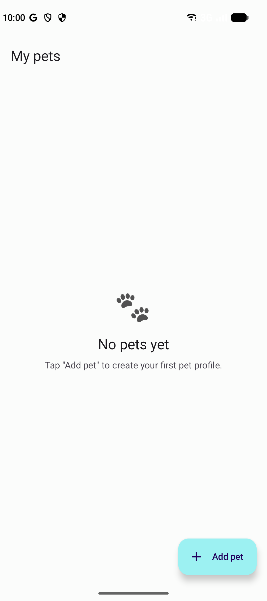
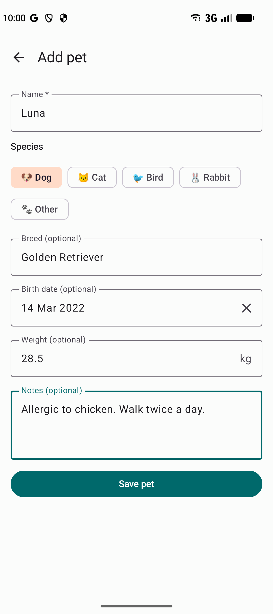
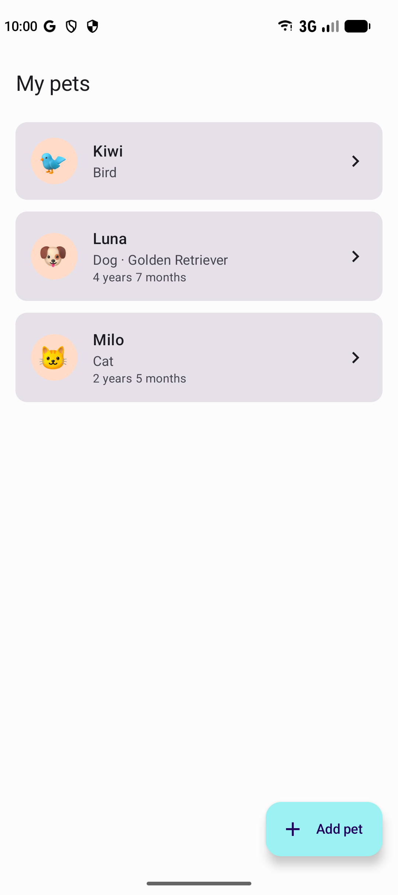
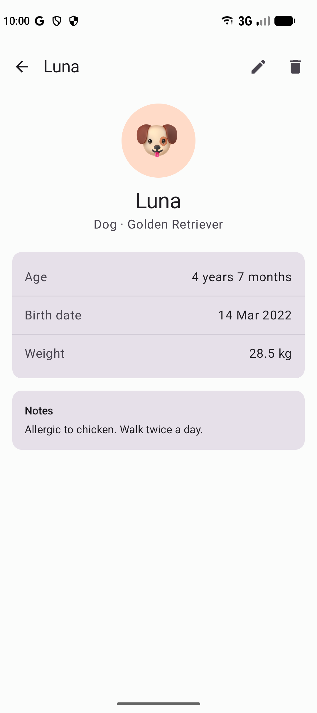
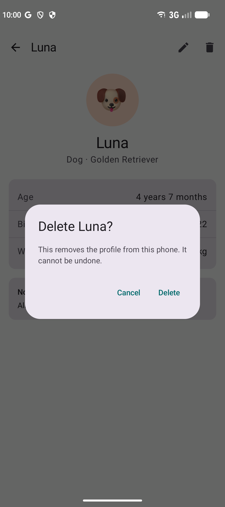
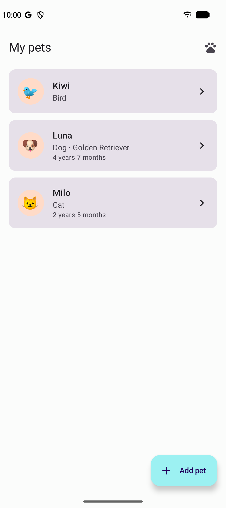
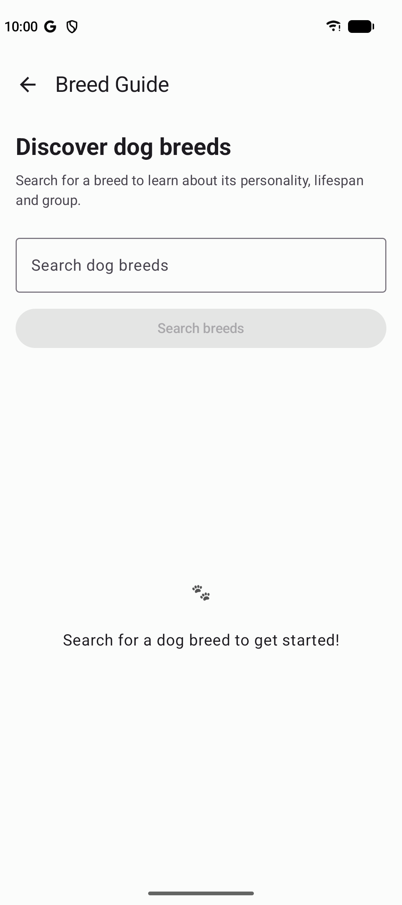
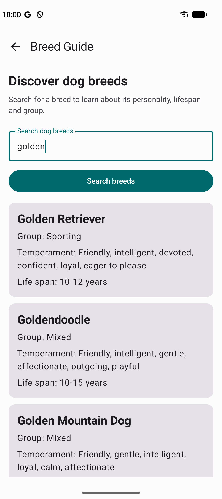
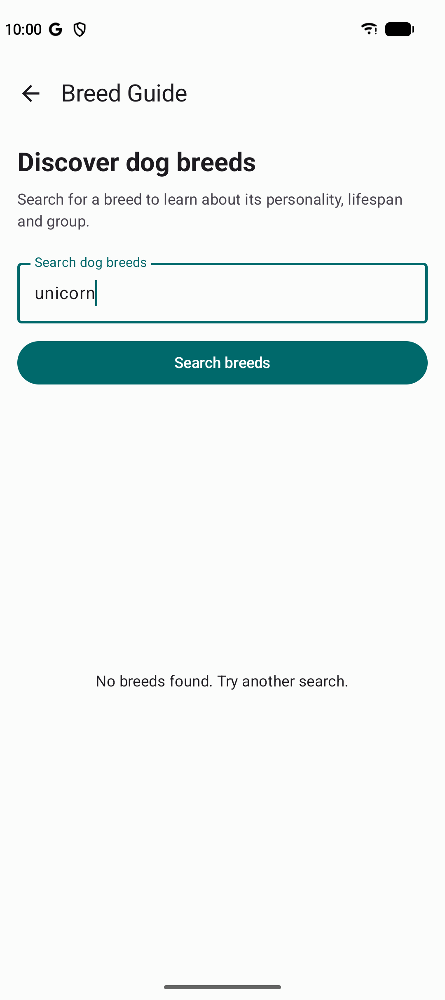
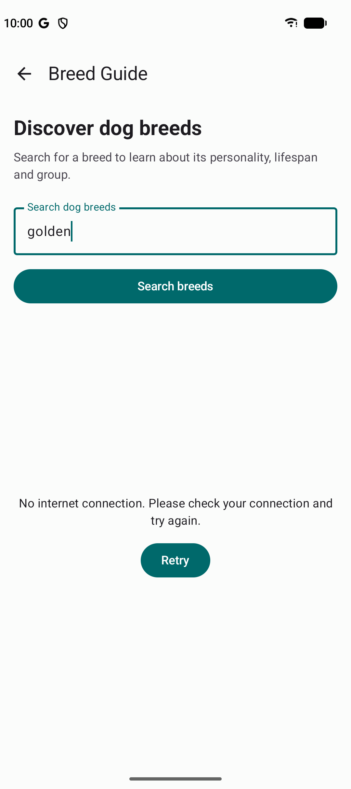

# Pet Care Routine and Reminder Log

Android app for pet owners who want one place for their pets' profiles, routine care and reminders.

Android Development course project · Group 4 · Yorgo Moukarzel and Maria Moussallem

## Status (midterm)

| Feature | Owner | Status |
|---|---|---|
| App setup, navigation, pet profiles | Yorgo | Done |
| Dog breed guide (API) | Maria | Done |
| Care tasks and recurrence | Yorgo | Next |
| Today's care, activity log and reminders | Maria | Next |

A short demo video is in [`docs/demo.mp4`](docs/demo.mp4).

## How to run

Requirements: Android Studio (recent stable version) and an emulator or phone with Android 8.0 (API 26) or newer.

1. Clone the repository:
   ```
   git clone https://github.com/YorgoMk/Pet-Care-Android.git
   ```
2. Open the `Pet-Care-Android` folder in Android Studio and wait for Gradle sync to finish.
3. Breed guide only: get a free key at [thedogapi.com](https://thedogapi.com) and add this line to `local.properties` in the project folder (the file is ignored by Git, so the key is never committed):
   ```
   DOG_API_KEY=your_key_here
   ```
   Without a key, pet profiles work normally and the breed search shows "The breed service rejected the API key".
4. Select the `app` run configuration and press Run.
5. Unit tests:
   ```
   ./gradlew testDebugUnitTest
   ```

## Features

### Pet profiles (Yorgo)

- Create, view, edit and delete pet profiles: name, species, breed, birth date, weight and notes.
- Validation: name required (max 30 characters), weight between 0 and 150 kg (comma or dot), birth date not in the future.
- Stored in Room, so profiles are still there after the app is closed and reopened.

| Empty list | Validation | Filled form | Pet list |
|---|---|---|---|
|  |  |  |  |

| Pet detail | Edit | Delete confirmation | After restart |
|---|---|---|---|
|  |  |  |  |

### Dog breed guide (Maria)

- Opened from the paw icon on "My pets". The user types a breed name and taps Search.
- `GET https://api.thedogapi.com/v1/breeds/search?q=...` with Retrofit and Gson. An OkHttp interceptor adds the `x-api-key` header from `BuildConfig.DOG_API_KEY`.
- The screen shows a start message, a loading spinner, results, "No breeds found", or an error with Retry.
- Errors are told apart: no connection, rejected key (401/403), server error (5xx, with the code).
- Pet profiles keep working offline; only this screen needs the internet.

| Entry point | Start | Results | No match | Offline error |
|---|---|---|---|---|
|  |  |  |  |  |

## Technical design

- **UI:** Jetpack Compose with Material 3. Each screen is a stateless composable that receives a UI state and callbacks; a small `Route` composable connects it to its ViewModel.
- **Navigation:** one Activity and a Navigation Compose `NavHost`. Routes: `pets` (start), `pets/add`, `pets/{petId}`, `pets/{petId}/edit`, `breed-guide`. Only the NavHost calls `navigate()` and `popBackStack()`.
- **State:** one ViewModel per screen, exposing `StateFlow`; work runs in `viewModelScope`.
- **Local storage:** Room (`pets` table) behind `PetRepository`. Reads are `Flow`s, writes are `suspend` functions.
- **Network:** Retrofit `DogApiService` behind `BreedRepository`, which maps `BreedDto` to `Breed`.
- **Dependencies:** a small `AppContainer` built in `PetCareApplication` creates the database and repositories once; `AppViewModelProvider` builds the ViewModels.
- **Background work:** none yet. Reminders will use WorkManager (approximate timing, unique work per task).

Data flow for "Save pet": the screen calls `onSave()` → `PetFormViewModel` validates and calls `PetRepository.savePet()` in `viewModelScope` → `PetDao.upsert()` writes to Room → Room's `Flow` emits the new list → `PetListViewModel` maps it to `PetListUiState` → Compose redraws.

```
app/src/main/java/com/usj/petcare/
  model/             Pet, Species, PetAge, Breed
  data/local/        AppDatabase, PetDao, PetEntity
  data/remote/       DogApiService, DogApiClient, BreedDto
  data/repository/   PetRepository, BreedRepository
  data/AppContainer.kt
  ui/navigation/     PetCareNavHost
  ui/view_model/     ViewModels and PetFormValidator
  ui/pets/           pet list, detail and add/edit screens
  ui/breeds/         breed guide screen
  ui/theme/          Material 3 theme
app/src/test/        32 unit tests (validation, repositories, ViewModels) with fake DAO and API
```

Built with Kotlin 2.2, AGP 9.4, Compose BOM 2026.02, Navigation 2.10, Room 2.8 (KSP), Retrofit 3.0. minSdk 26, targetSdk 37.

## Team workflow

- One short-lived branch per feature (`feature/yorgo-pet-profiles`, `feature/maria-breed-guide`), merged through a pull request reviewed by the other member.
- Secrets stay in `local.properties`, which is never committed.

| Owner | Work package |
|---|---|
| Yorgo | App setup and navigation · pet profiles · care tasks and recurrence |
| Maria | Breed guide (API) · today's care and activity log · reminders · settings |

## Scope

The app helps owners organise routine care. It does not diagnose symptoms, recommend treatments, integrate veterinary records or handle payments.
