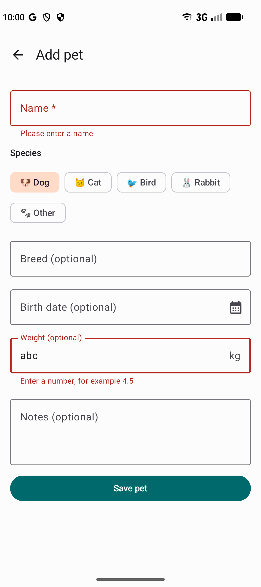

# Pet Care Routine and Reminder Log

Android course project — Group 4 — Yorgo Moukarzel and Maria Moussallem.

Repository: https://github.com/YorgoMk/Pet-Care-Android

Local development folder: `/Users/yorgomk/Desktop/Pet-Care-Android`.

This is a new Android project. The existing PetCare repository and Desktop folder are a separate older project.

## Required scope

The official Moodle topic brief requires pet profiles, recurring care tasks, locally persisted activity history, and a reminder for an upcoming task. Its shared expectations additionally require Compose UI, navigation, ViewModel-managed state, Room or DataStore, at least one API interaction with loading/error states, and a relevant Android capability. Reminders cover the latter.

Midterm: create a pet, complete one care task, retain its log after restarting, and configure a reminder. Each student must explain their contribution and the state/data flow.

Final: running app, repository and README, short report, live demonstration, and individual technical Q&A. Use issues, short-lived feature branches, focused commits and review before merge.

No diagnosis, treatment recommendations, veterinary-record integration or payments. Keep one optional extension for after the MVP is reliable. User-entered care instructions are not app-generated medical advice.

Source: Moodle Final Project Topics, `Android_Final_Project_Topic_Briefs.docx`, topic 7 and the shared Project expectations table. Team assignment: `Android_project_groups.xlsx`, Project Groups!A5:E5. The brief describes approximately six weeks; no specific deadline was found.

## Build order

1. Create a fresh Kotlin/Compose Android app inside the new Desktop repository. Confirm both teammates can clone, build and run it. Agree on package name, shared models and basic screen callbacks before branching.
2. Establish the minimum navigation graph and Room data model: Pet, CareTask and CareLog. Decide simple recurrence rules and what happens to logs when a task is edited or deleted.
3. Build one complete journey: create pet → add task → mark complete → see saved history after restart.
4. Add reminder configuration and delivery. Define whether delivery is approximate; do not promise exact timing from WorkManager. Cover disabled notifications, edited tasks, duplicates and completed/deleted tasks.
5. Add one small API-backed breed-information feature using Retrofit, DTO mapping, repository, ViewModel and loading/content/empty/error/retry states. Select the endpoint after checking its contract and access requirements. Keep care functions usable offline.
6. Finish recurring-task dates, filtering, validation and restart behavior. Test on an emulator and, if possible, a physical device.
7. Each person reviews the other's changes, writes their contribution statement and rehearses explaining their own code. Finish the README, short report and demonstration.

The proposed API feature is our choice to satisfy the shared requirement; the instructor does not prescribe a specific pet API. Notification details and persistence patterns require reading the relevant course PowerPoints before implementation.

## Equal work allocation

Points are relative effort estimates, not grades or hours. Both students have 16 points and own UI, state, data and tests for their assigned features. Rebalance after the first working journey if actual effort differs.

| Owner | Work package | Points | Completion check |
|---|---|---:|---|
| Yorgo | Fresh app setup and navigation | 3 | App runs; screens are registered; forward and Back actions work through callbacks |
| Yorgo | Pet profiles end to end | 5 | Create/edit/list profiles, validate input, persist through restart, and test repository behavior |
| Yorgo | Care tasks and recurrence | 5 | Create/edit routines for a pet, compute next due date for agreed recurrence rules, and test date boundaries |
| Yorgo | Integration and delivery contribution | 3 | Review Maria's PRs; test navigation and recurrence integration; write setup/data-model README sections and own contribution statement |
| Maria | Today's care and activity history | 5 | Show due tasks, complete an occurrence once, save its log, and show history after restart |
| Maria | Reminder configuration and delivery | 5 | Schedule useful reminders; handle permission denial, rescheduling and cancellation; test duplicate prevention |
| Maria | API-backed breed information | 3 | Retrofit/repository/ViewModel feature with loading, content, empty, failure and Retry behavior |
| Maria | Settings and delivery contribution | 3 | Persist reminder preference; review Yorgo's PRs; test reminder/API failure paths; write user-flow/testing report sections and own contribution statement |

Both jointly agree the data model, integrate changes frequently, check the end-to-end midterm flow and rehearse the final demo. Shared-file changes should be coordinated rather than assigned to two long-lived branches.

## Course implementation approach

Use Compose screens driven by state and callbacks; ViewModels own screen state; repositories own data operations; Room stores structured pet/task/log data. Keep navigation mechanics in the NavHost. Use Retrofit suspend calls and DTO mapping for the API feature. Choose background APIs by work lifetime; WorkManager is durable and deferrable, not an exact alarm. Do not add accounts, a custom backend or advanced architecture unless a requirement warrants it.

Use a feature branch per issue, such as `feature/yorgo-pet-profiles` or `feature/maria-care-history`. Open a pull request, have the other person review, then merge and update the local main branch. Each person authors their own commits; do not fabricate equal contribution through commit attribution. Commit neither credentials nor machine-specific local.properties.

## Current setup status

The Android project is set up (Kotlin, Jetpack Compose, Material 3, Navigation Compose, Room with KSP, minSdk 26, targetSdk 37). Package: `com.usj.petcare`.

| Feature | Owner | Status |
|---|---|---|
| App setup, navigation, pet profiles | Yorgo | Done on `feature/yorgo-pet-profiles` |
| Dog breed guide (API) | Maria | In progress on her own branch |

## How to run

1. Open the folder in Android Studio and let Gradle sync.
2. Run the `app` configuration on an emulator (API 26+).
3. Unit tests: `./gradlew testDebugUnitTest`.

## Code layout

```
app/src/main/java/com/usj/petcare/
  model/                 Pet, Species, PetAge (plain Kotlin, no Android)
  data/local/            Room: AppDatabase, PetDao, PetEntity
  data/repository/       PetRepository (the only door to pet data)
  data/AppContainer.kt   Builds the database and repositories once
  ui/navigation/         PetCareNavHost: routes and the back stack
  ui/view_model/         One ViewModel per screen + PetFormValidator
  ui/pets/               Compose screens: list, detail, add/edit form
```

Data flow for one change: the screen reports an event (e.g. Save) → the ViewModel validates and calls the repository in `viewModelScope` → the repository converts `Pet` to `PetEntity` and calls the DAO → Room writes the row and its `Flow` emits a new list → the list ViewModel maps it to `PetListUiState` → Compose redraws.

## Feature 1: pet profiles (Yorgo)

- Create, view, edit and delete pet profiles (name, species, breed, birth date, weight, notes).
- Validation: name required (max 30 chars), weight must be a number between 0 and 150 kg (comma or dot), birth date cannot be in the future.
- Saved in Room, so profiles are still there after the app is closed and reopened.
- Unit tests: validation, age labels, repository and the form ViewModel (21 tests).

| Empty list | Validation | Filled form | Pet list |
|---|---|---|---|
|  |  |  |  |

| Pet detail | Edit | Delete confirmation | After restart |
|---|---|---|---|
|  |  |  |  |
